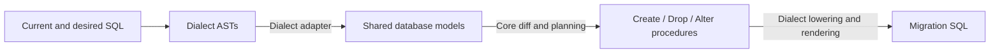

# uncutsql — Effect foundation

A new implementation of uncutsql with a bidirectional SQL grammar, structural
schema comparison and composable Effect operations. The CLI checks, formats and
compares supported SQLite schema files and generates migrations for a limited set
of changes.

## Run

Requires Node **24.11+** and pnpm **12.4.2**. Dependencies are locked; Effect is
pinned to **4.1.4**. TypeScript runs directly through Node's type stripping.

```sh
pnpm install
pnpm check
pnpm test
pnpm demo
pnpm build
```

`check` runs formatting, lint, package tests and TypeScript checks, including
compile-only inference tests. Runtime tests cover both codec
directions, failure semantics, source locations, concurrent execution, service
Layers and custom logging. Selected SQL fixtures were copied unchanged from the
previous implementation; tests also compare their schemas with Node's built-in
SQLite. Node may print an experimental SQLite warning when running those tests.

## Workspace

- `libs/codec` — `@uncutsql/codec`, the generic Effect codec library.
- `libs/core` — `@uncutsql/core`, shared database models, diff and logical migration procedures.
- `libs/sqlite` — `@uncutsql/sqlite`, SQLite AST/model conversion and migration SQL.
- `libs/cli` — `@uncutsql/cli`, a CLI package with an `uncutsql` executable and API.
- `libs/sqlite-driver` — `@uncutsql/sqlite-driver`, optional native SQLite execution.
- `apps/demo` — `@uncutsql/demo`, an executable consumer of both libraries.

Each library owns its tests; SQLite fixtures stay beside its tests. Shared
TypeScript settings live in `tsconfig.base.json` and `tsconfig.node.json`.
Workspace exports resolve to TypeScript source so tests and the demo work without
building first. `pnpm build` builds libraries in dependency order with tsdown,
producing ESM, CommonJS and declarations in each library's `dist` directory.
Packages remain private; build configuration includes distribution export maps.

Use `pnpm --filter @uncutsql/sqlite check` to check one library,
`pnpm check:types` for workspace type checks, and `pnpm fix:format` to format.
The root `pnpm test` alias still runs all runtime tests.

## Schema CLI

The [demo walkthrough](apps/demo/README.md) includes schemas, plugin configuration
and a migration sequence. `pnpm demo` runs the Effect/logging example;
`pnpm demo:cli` runs the CLI from `apps/demo`, where it discovers that config.
Paths in the following demo commands are relative to `apps/demo`:

```sh
pnpm demo:cli check examples/schema.sql
pnpm demo:cli format examples/schema.sql
cat apps/demo/examples/schema.sql | pnpm demo:cli format
pnpm cli --help
```

Both commands accept a file path relative to your current directory, or stdin
when the path is omitted or `-`. `check` validates supported syntax without
executing SQL or checking database semantics. `format` writes canonical SQL to
stdout after the entire input succeeds; input files are never modified.
Canonical output does not preserve comments or formatting, except significant
spelling within type declarations. Unsupported statements and expressions fail
with a filename, line, column and source excerpt. Exit codes are 0 for success,
1 for input/SQL failures, and 2 for invalid command usage.

Files can contain multiple supported CREATE TABLE statements, separated by
semicolons. The final semicolon is optional; empty statements and empty files
are accepted. Subqueries and other statement kinds remain unsupported.

The library exposes the same file grammar through `Sqlite.schema.decode(sql)`,
`encode(statements)` and `decodeWithSourceMap(sql)`. It returns an ordered
`readonly Statement[]` and keeps source offsets relative to the original file.

## Dialect boundaries

The reusable engine compares a shared database representation rather than parser
ASTs. Each dialect owns SQL parsing, conversion and normalization, selection of
physical operations, and SQL rendering:



`@uncutsql/core` has no dependency on SQLite or the codec package. Its model has
separate catalog/schema identity fields and adapter-supplied column keys. Shared
comparison does not assume case-insensitive names, a default namespace, SQLite
options or SQLite ALTER TABLE limitations. Structured type/constraint values and
namespaced vendor options are compared without discarding dialect details.
The current model covers tables and their columns/constraints/options; more object
kinds and additional dialect adapters can be added without moving the diff back
into a dialect.

```ts
import { diffDatabases, planDatabaseMigration } from "@uncutsql/core";
import { dialect } from "@uncutsql/sqlite";

const beforeDatabase = yield * dialect.toDatabaseSchema(beforeAst, "before");
const afterDatabase = yield * dialect.toDatabaseSchema(afterAst, "after");
const diff = yield * diffDatabases(beforeDatabase, afterDatabase);
const logicalMigration = planDatabaseMigration(diff);
// Generic intent; SQLite decides whether an AlterTable needs a rebuild.
const sqlitePlan = yield * dialect.lowerMigration(logicalMigration, beforeDatabase, afterDatabase);
const migrationSql = yield * dialect.encodeMigration(sqlitePlan);
```

Database models are serializable; migration planning also works after JSON
restoration, without the original parser AST. SQLite's `fromDatabaseSchema`
validates its supported model values before producing ASTs. It rejects unknown
vendor options, structured types it cannot render, and unsupported constraints.
This boundary does not promise that SQLite can render another dialect's features.
The dialect does not export diff or logical-planning functions. Users and the CLI
compose core with a `Dialect<Ast, PhysicalPlan, Error, Services>` adapter, which
exposes parse/format, model conversion, procedure lowering and SQL rendering.
The CLI loads its configured adapter through `libs/cli/src/plugins.ts`; its generic workflow in
`libs/cli/src/workflow.ts` imports comparison and logical planning from core.
Swapping the adapter changes no comparison code. Core supplies the interface but
does not discover, import or select dialect packages.

## Compare schemas

```sh
pnpm demo:cli diff examples/schema.sql examples/schema-next.sql
```

`diff` prints core's shared JSON report from the current schema to the desired
schema, using catalog/schema/name identities and `dataType` column fields. It reports added/removed tables, added/removed/changed columns, changes
to the relative order of shared columns, table constraints and table options.
Definitions are included for later migration planning. Additions/removals include
zero-based column positions. One input may be `-` for stdin. Success exits 0 even
when changes exist; parse, input and ambiguous-schema errors exit 1.

Tables match by schema/name and columns by name, ignoring ASCII case. Unqualified
names use `main`, TEMP tables use `temp`. Table declaration order and IF NOT EXISTS
are ignored; STRICT/WITHOUT ROWID flags ignore order and duplicates. Duplicate
table or column identities and contradictory TEMP/schema declarations fail with
structured library diagnostics instead of silently overwriting definitions.

This is a conservative structural comparison. Declared type text is retained
exactly; constraints compare normalized structured values in their original order. Equivalent
expressions, constraint identifiers with different case, and equivalent ways of
writing constraints can still produce differences. Renames appear as remove/add.
The diff report does not generate, execute or order migration operations, validate all
database semantics, or assess whether a change can preserve existing data.

```ts
const before = yield * dialect.toDatabaseSchema(yield * dialect.parse(beforeSql), "before");
const after = yield * dialect.toDatabaseSchema(yield * dialect.parse(afterSql), "after");
const diff = yield * diffDatabases(before, after);
// { changes: [{ _tag: "TableChanged", table, before, after, changes: [...] }] }
```

The core API returns `Effect<DatabaseDiff, SchemaDiffError>` without service
requirements. SchemaDiffError contains a diagnostics array identifying the input
side, table and (when applicable) column. Conversion errors belong to the dialect;
comparison does not mutate inputs or access a database. Diff diagnostics use the
shared identity shape (catalog/schema/name); SQLite places its database namespace
in catalog.

## Generate migration SQL

```sh
pnpm demo:cli migration examples/schema.sql examples/schema-next.sql
```

The command prints a transaction script to stdout. It never executes SQL, changes
input files or writes a lock file. Identical schemas produce empty output. The
baseline must describe the actual database, and attached schemas must already
exist. Run the generated transaction outside an existing transaction. As with
`diff`, one input may be stdin; unsupported changes fail before any SQL is emitted.

The planner supports:

- Creating tables with explicit schema placement and without IF NOT EXISTS.
- Dropping tables in child-before-parent foreign-key order, with data-loss warnings.
- Appending simple columns directly with ALTER TABLE ADD COLUMN.
- Rebuilding tables for column changes, insertion/reordering/removal, constraints,
  table options, and additions SQLite cannot perform with ADD COLUMN.

Rebuilds create a replacement table, copy matching names and explicitly resolved rename mappings, drop the old
table, and rename the replacement. New columns use defaults; generated columns
are recomputed. Removed columns produce data-loss warnings. Accessible hidden
rowids are copied when both tables support rowids; a changed INTEGER PRIMARY KEY
can determine a different rowid. Retained AUTOINCREMENT high-water marks are preserved. Column/table removals require explicit decisions in CLI workflows. Rename similarity
heuristics and custom data transformations are not implemented. Copying can fail when existing
rows violate the desired constraints or types; rows are never silently ignored or
replaced to make a migration succeed.

**Rebuild scripts require execution outside a transaction and stop-on-error
behavior.** They disable foreign keys before BEGIN, check foreign keys before
commit, then enable enforcement after success. On failure, roll back any open
transaction and restore `PRAGMA foreign_keys=ON`; generation cannot perform that
cleanup for a caller. Copy and validation constraint failures request a rollback.
Simple migrations retain the existing foreign-key setting.

Standalone indexes, including unique, expression and partial indexes, are modeled
separately from PRIMARY KEY/UNIQUE constraints. Index-only changes use DROP/CREATE
INDEX; rebuilds recreate all desired indexes after copying the table.
Runtime checks refuse unrepresented or missing explicit indexes, triggers on rebuilt
tables and any views in affected schemas (including temporary views/triggers).
Views and triggers cannot yet be preserved. Rebuilds with all hidden
rowid aliases shadowed, no writable copy mapping, retained references to removed
tables, and cyclic/self-referential table drops still produce planning errors.
The baseline must cover all table declarations involved; a live database can still
have drift or other semantic errors that cause execution to fail.

```ts
const { diff: resolved } = yield * resolveMigrationDecisions(before, after, decisions);
const procedures = planDatabaseMigration(resolved);
const plan = yield * dialect.lowerMigration(procedures, before, after);
// SQLite plan: { operations: [...], warnings: [...] }
const sql = yield * dialect.encodeMigration(plan);
```

SQLite plans retain typed CreateTable, DropTable, AddColumn and RebuildTable operations.
Core logical planning is pure. SQLite lowering returns SchemaDiffError, EncodeError
or MigrationPlanError; rendering returns EncodeError.
The generation workflow below records the baseline and last generated migration ID,
separately from the history of migrations actually applied to a database.

## Generate migration files with a lock

```sh
pnpm demo:cli generate examples/schema.sql .local/migrations
pnpm demo:cli generate examples/schema-expand.sql .local/migrations
# Or choose an output directory:
pnpm cli generate schema.sql db/migrations
```

`generate` reads the desired schema (a file or `-` for stdin), compares it to the
recorded baseline, and writes the next numbered SQL file and `uncutsql.lock.json`.
The default output directory is `migrations`. A missing lock and empty migration
history mean an empty database baseline, so the first generation creates all
specified tables. Generation never connects to a database or applies SQL.
Commit numbered SQL files and the lock together.

The lock stores version 1, the selected dialect name, the shared database model,
`lastMigrationId`, and the latest migration's SHA-256 hash. The stored model is
shape-validated before comparison. IDs start at 1 (`000001.sql`) and advance only
when a migration is published. Equivalent schemas print `No schema changes.` and
do not rewrite the lock or create a migration. The command may create an empty
output directory on an initial no-op.

Publication stages and syncs both files, publishes complete SQL without replacing
an existing file, then atomically replaces the lock as its commit point. A writer
lock serializes runs. Failures before commit leave the old baseline in place and
remove output owned by that attempt; foreign files are never overwritten. A
post-commit cleanup failure explicitly reports that the files were published.
The output filesystem must support hard links, atomic rename and directory sync.

Corrupt/unsupported locks, a different dialect, missing or extra numbered files,
and a modified latest migration cause an error rather than resetting the baseline.
All numbered files from 1 through the locked ID must remain present. The latest
SQL checksum is verified; earlier migration contents are not rehashed by this
format. Interrupted runs can leave a writer lock, staging files or an uncommitted
SQL file. Reconcile those files with the recorded baseline before retrying; remove
the writer lock only after confirming no command is using the migration directory. Automatic recovery
is not implemented. Database application and its history are separate, as described
below.

## Apply generated migrations

```sh
pnpm demo:cli generate examples/schema.sql .local/migrations
pnpm demo:cli apply .local/app.sqlite .local/migrations
pnpm demo:cli generate examples/schema-next.sql .local/migrations
pnpm demo:cli apply .local/app.sqlite .local/migrations
# Or read a different migration directory:
pnpm cli apply app.sqlite db/migrations
```

`apply` loads a consistent generated history, validates the lock, and applies only
pending files. It never changes generated SQL or the lock. Applied IDs, checksums,
format/dialect metadata, timestamps and shared schema snapshots live separately in
the database's reserved `__uncutsql_migrations` table. An up-to-date run prints
`Database is up to date.`

Each SQL file and its history row commit in the **same transaction**. A failed file
is rolled back and remains pending; earlier successful files remain committed.
After fixing the underlying data problem, rerun `apply` to resume. The driver
restores foreign-key enforcement and closes the connection on success or failure.
Independent database writers serialize with BEGIN IMMEDIATE and a five-second
busy timeout. Application refuses edited applied files, incomplete/ahead history,
and normalized schema drift from the last applied snapshot. Before the last
pending file commits, the CLI also verifies its schema against the generation lock.

The first executor uses Node's SQLite support and accepts a persistent **main
SQLite database file only**. It refuses to adopt an existing nonempty database
without application history. Attached/temporary database migrations, baseline
adoption, rollback/down migrations and views/triggers are not
yet supported. `__uncutsql_migrations` is reserved for application metadata.
Migration scripts must use the generated BEGIN/COMMIT envelope; PRAGMAs outside
it are limited to the emitted foreign-key settings. An initial failed attempt can
leave an empty database file, which the runner does not delete automatically.

Execution is optional and separately swappable: `MigrationExecutor` is a core type
contract; `--driver` or configuration selects an adapter such as
`@uncutsql/sqlite-driver`. The SQLite dialect package has no driver dependency
or production database imports. Core schema comparison and final verification are wired by
the CLI; the driver does not import diff or logical-planning functions.

## Selecting dialects and drivers

The CLI depends on core contracts and codecs, never on a concrete dialect or
driver. The SQLite dialect is driver-free; `@uncutsql/sqlite-driver` owns native
database access and depends on the dialect for schema inspection.

Install chosen plugins in the calling project and configure module specifiers:

```json
{
  "dialect": "@uncutsql/sqlite",
  "driver": "@uncutsql/sqlite-driver"
}
```

Save this as `uncutsql.config.json` (or use `.uncutsqlrc.json`, a default-exported
`uncutsql.config.{js,cjs,mjs,ts,cts,mts}`, or the `uncutsql` object in package.json).
The package.json field takes precedence over discovered config files. An explicit
`--config path` selects just that file. `--dialect module` and `--driver module`
override its values. Package specifiers resolve from the config's directory;
relative module paths resolve there too. Flag specifiers resolve from the caller's
working directory. Absolute paths and file URLs also work.

```sh
uncutsql format schema.sql --dialect @uncutsql/sqlite
uncutsql apply app.sqlite --driver @uncutsql/sqlite-driver
uncutsql check schema.sql --config uncutsql.config.json
```

The demo config in `apps/demo/uncutsql.config.json` selects installed workspace
packages by name. There is no root example configuration. The CLI itself
has no default dialect or driver. Syntax/generation commands load only a dialect;
`apply` loads only a driver and checks its dialect ID against the generation lock.
Plugins export `dialect` / `executor`, or a default adapter implementing the core
contract, with any required Effect services already provided. Loading and shape
validation failures produce CLI diagnostics. Config files are executable when
using JavaScript or TypeScript.

The CLI is built as a package with a distribution `bin`, not as an app. Its
integration tests live in `apps/demo`, which explicitly installs the chosen plugins.

## Parse and serialize

```ts
import { Effect } from "effect";
import * as Sqlite from "@uncutsql/sqlite";

const program = Effect.gen(function* () {
  const ast = yield* Sqlite.createTable.decode(`
    create table users (
      id INTEGER PRIMARY KEY,
      name TEXT NOT NULL DEFAULT 'O''Brien'
    )
  `);
  return yield* Sqlite.createTable.encode(ast);
});

const sql = await Effect.runPromise(program);
// CREATE TABLE "users" ("id" INTEGER PRIMARY KEY, "name" TEXT NOT NULL DEFAULT 'O''Brien');
```

All library operations return Effects. Only the application boundary runs them.
Errors are `ParseError` or `EncodeError` in the typed error channel. Custom codecs
can add their own errors and services.

The AST can also be constructed directly using `Sqlite.CreateTable`; source
metadata is never required for encoding. Constraints stay in their original
order. An absent column type is represented by `typeName: undefined`.
Tables contain `columns` and `tableConstraints` arrays; use `tableConstraints: []`
when constructing a table with no table-level constraints. Optional constraint
names are stored in `name` on the corresponding constraint node. Optional
`schema` qualifies the table name without changing `name`; omitted schemas remain
implicit. Optional table `options` retain the ordered `"STRICT"` / `"WITHOUT ROWID"` spellings.
`typeName` is validated SQL text: quoted words and internal trivia are retained
because their spelling can affect SQLite's declared type and affinity.

Use `Sqlite.createTable.decodeWithSourceMap(sql)` for `{ value, source, sourceMap }`.
The source map is a separate nested tree of named syntax spans with zero-based,
end-exclusive UTF-16 offsets. Parse errors additionally carry one-based line and
column numbers, expectations and commitment status.

## Compose logging

```ts
import { Effect, Logger, References } from "effect";
import * as Codec from "@uncutsql/codec";
import * as Sqlite from "@uncutsql/sqlite";
import { trivia } from "@uncutsql/sqlite/tokens";

const sql = Codec.document(Codec.observe("sqlite.createTable", Sqlite.createTableGrammar), trivia);

const program = sql
  .decode("CREATE TABLE t (id INTEGER)")
  .pipe(
    Effect.annotateLogs({ filename: "schema.sql" }),
    Effect.provideService(References.MinimumLogLevel, "Debug"),
    Effect.provide(Logger.layer([Logger.consoleJson])),
  );

await Effect.runPromise(program);
```

`observe` adds spans and successful-operation debug events without logging source
SQL or AST contents. The caller supplies loggers, levels and tracing exporters.
It can wrap a whole grammar or individual rules. For application-level events,
compose `Effect.tap`, `Effect.tapError`, and `Effect.log` directly.

## Expressions

```ts
const ast = yield * Sqlite.sqlExpression.decode("a - (b - c)");
const sql = yield * Sqlite.sqlExpression.encode(ast);
// "a" - ("b" - "c")
```

`Sqlite.expression` is the composable grammar; `Sqlite.sqlExpression` is its
whole-document entry point. The parser and encoder share SQLite's precedence
table. Parentheses shape the semantic tree and remain in the source map; the
encoder inserts the parentheses required to preserve that tree. Equal-precedence
right children stay grouped even for addition and multiplication.

Numeric literals use `{ _tag: "NumericLiteral", value: "9007199254740993" }`.
The value is SQL text, not a JavaScript number: this preserves large integers and
the difference between INTEGER and REAL expressions such as `1 / 2` and `1.0 / 2`.
Signs are unary-expression nodes. Blob values contain hexadecimal byte pairs.

## Supported SQLite slice

- One `CREATE [TEMP | TEMPORARY] TABLE [IF NOT EXISTS] [schema.]name (...)` statement.
- Bare non-keyword identifiers and double-quoted, backtick or bracket identifiers.
  Output always uses escaped double quotes.
- One or more columns, with optional custom, multiword or parameterized types.
  Type parameters accept one or two signed numeric literals.
- Ordered column `PRIMARY KEY`, `NOT NULL`, `UNIQUE`, `DEFAULT`, `CHECK`, and
  `REFERENCES`, `COLLATE`, and generated-column constraints, optionally named
  with `CONSTRAINT name`. Column keys support sort order and `AUTOINCREMENT`;
  PRIMARY KEY, NOT NULL and UNIQUE support `ON CONFLICT` actions.
- `[GENERATED ALWAYS] AS (expression) [VIRTUAL | STORED]` columns.
- Comma-separated `STRICT` and `WITHOUT ROWID` table options.
- Named or unnamed table-level `PRIMARY KEY`, `UNIQUE`, `CHECK`, and `FOREIGN KEY`.
  Table keys support per-column collation/order and `ON CONFLICT` actions.
- Column and composite table foreign keys, optional referenced column lists,
  `ON DELETE`/`ON UPDATE` actions, `MATCH`, and `[NOT] DEFERRABLE [INITIALLY ...]`.
  Reference options retain their original order.
- String, numeric (decimal, exponent, hexadecimal and digit separators), blob,
  NULL, current-time/date/timestamp and TRUE/FALSE literal spellings. TRUE/FALSE
  remain keywords on output so SQLite retains its contextual name resolution.
- Column references with one, two or three identifier components.
- Row values `(a, b, ...)`, row comparisons, BETWEEN and row-list membership.
- Bind parameters `?`, `?NNN`, `:name`, `@name`, `$name`, with namespace/suffix
  extensions and exact token spelling. Defaults reject parameters. SQLite validates
  parameter-number limits and whether bindings are permitted in a statement context.
- Ordinary function calls with zero or more expression arguments, including nested calls.
  Function names use identifier syntax and are quoted on output. Calls support `*`,
  DISTINCT/ALL, argument ORDER BY, FILTER and OVER with named windows, partitioning,
  ordering and frame specifications.
- Unary `+`, `-`, `~`, `NOT`; arithmetic `+`, `-`, `*`, `/`, `%`; concatenation `||`;
  bitwise `&`, `|`, `<<`, `>>`; comparisons `<`, `>`, `<=`, `>=`, `=`, `!=`, `IS`,
  `IS NOT`; postfix `ISNULL`, `NOTNULL`, `NOT NULL`; and logical `AND`, `OR`.
  Equality and IS DISTINCT FROM aliases normalize
  to their equivalent canonical operators.
- JSON extraction `->` and `->>`, retaining JSON text versus SQL value semantics.
  Paths, labels, indexes and chained extraction use ordinary expressions.
- LIKE, GLOB, REGEXP and MATCH with NOT forms and optional ESCAPE syntax.
  SQLite validates pattern-function availability and escape values at execution time.
- `BETWEEN` and `NOT BETWEEN` range expressions, including nested bounds.
- `IN` and `NOT IN` with parenthesized expression lists, including empty lists.
  Subquery, table-name and table-function targets are not implemented.
- `RAISE(IGNORE)` and `RAISE(ROLLBACK | ABORT | FAIL, expression)`; SQLite enforces
  trigger context, and the schema parser does not yet accept CREATE TRIGGER.
- Simple and searched `CASE` expressions with ordered branches, optional ELSE and nesting.
- `CAST(expression AS type)` with nested expressions and validated type declarations.
- Expression-level `COLLATE name`, including nested clauses and quoted/custom
  collation names. SQLite resolves the actual collation at execution time.
- Defaults containing literals, signed numbers or parenthesized constant expressions;
  column-reference defaults are rejected in both directions.
- Column- and table-level `CHECK (expression)`, with nested parentheses and column references.
- Whitespace, line comments and block comments, and an optional final semicolon.

The encoder produces canonical SQL with a final semicolon. Comments, original
whitespace, keyword casing and quote style are not reconstructed, except within
type declarations where the original spelling is significant. The round-trip
contract for supported, valid ASTs is `decode(encode(ast))` equal to `ast`.

This grammar deliberately requires quoting reserved words used as identifiers.
The built-in `temp` schema is accepted unquoted before a dot; other contextual
keyword fallbacks are not implemented. Unsupported syntax
fails: subqueries are not yet implemented. Neither are `AS SELECT` or statement kinds other than CREATE TABLE. Database semantics such as duplicate columns,
conflicting constraints and contextual name resolution remain SQLite's responsibility.

## Code layout

| Location                                                    | Responsibility                                                           |
| ----------------------------------------------------------- | ------------------------------------------------------------------------ |
| `libs/codec/src`                                            | Cursor, errors, bidirectional combinators, source maps and observability |
| `libs/sqlite/src/lexer`                                     | Character classes, keyword set and quoted-text scanner                   |
| `libs/sqlite/src/operators`                                 | Trivia, lexemes, keywords, punctuation and grammar helpers               |
| `libs/sqlite/src/codecs/*-literal.ts`                       | Separate codecs for each literal kind                                    |
| `libs/sqlite/src/codecs/expression`                         | Operator precedence, expression variants and AST types                   |
| `libs/sqlite/src/codecs/expression.ts`                      | Recursive precedence-climbing grammar and encoder dispatch               |
| `libs/sqlite/src/codecs/column-constraint`                  | Separate codec for each column constraint                                |
| `libs/sqlite/src/codecs/table-constraint`                   | Separate codecs for table keys, checks and foreign keys                  |
| `libs/sqlite/src/codecs/foreign-key`                        | Shared reference actions and deferrability rules                         |
| `libs/sqlite/src/codecs/type-name.ts` / `type-parameter.ts` | Validated type declarations and numeric dimensions                       |
| `libs/sqlite/src/codecs/table-options.ts`                   | Ordered STRICT / WITHOUT ROWID options                                   |
| `libs/sqlite/src/codecs/table-reference.ts`                 | Optional schema qualifier and table name                                 |
| `libs/sqlite/src/codecs/table-definition.ts`                | Column list followed by ordered table constraints                        |
| `libs/sqlite/src/codecs/create-table-statement.ts`          | Table grammar composed from its definition                               |
| `libs/sqlite/src/index.ts`                                  | Public API with `@uncutsql/sqlite/create-table` and `/tokens` subpaths   |
| `libs/*/tests`                                              | Runtime, SQLite compatibility, and compile-only type checks              |
| `libs/cli/src/index.ts`                                     | CLI file/stdin boundary and diagnostics                                  |
| `apps/demo/src/index.ts`                                    | Executable example with JSON logging                                     |

See [architecture notes](docs/architecture.md) for combinator contracts, the
relationship to the earlier experiments, and the next implementation steps.

## Resolve migration intent

A removed column plus an added column is ambiguous. The tool does not guess
whether data should be dropped or copied to a renamed column. Prepare a decision
file before generating a migration:

```sh
pnpm cli migration before.sql after.sql --write-decisions choices.json
# Set each resolution to {"_tag":"Drop"} or {"_tag":"Rename","target":"new_key"}.
pnpm cli migration before.sql after.sql --decisions choices.json
```

`generate desired.sql migrations` supports the same flags against its saved
baseline. Unresolved, stale and conflicting choices stop generation. Confirmed
renames retain separate type/constraint changes and SQLite currently implements
them with a rebuild. Validated decisions are persisted inside the hashed SQL;
review that concrete script before running apply. See the
[demo rename walkthrough](apps/demo/README.md#resolve-a-column-rename).
